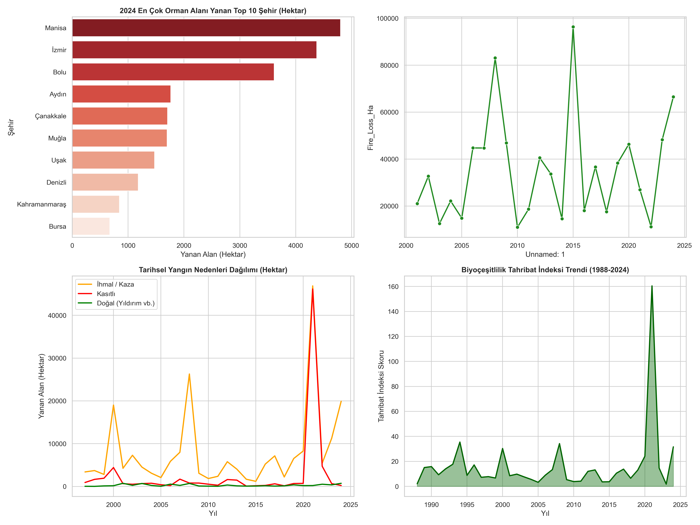
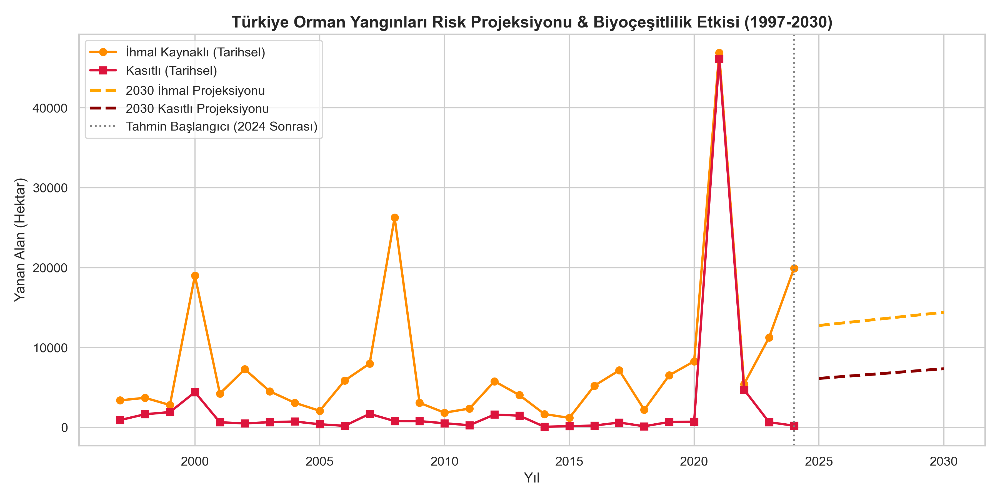

# 🌲 Wildfire Impact & Predictive Environmental Modeling (1988–2030)

An end-to-end ESG Analytics and Machine Learning project evaluating 36+ years of historical wildfire data, regional biodiversity risk drivers, and projecting 2030 burn coverage across Türkiye using Python & Scikit-Learn.

---

## 📌 Project Overview & Program Context
This project was initially developed as part of the **Gelecek Hayalim – W-CODE 2.0** talent program supported by **Ford Otosan, Mikado Impact, Vehbi Koç Vakfı, and Kodluyoruz**. 

Building upon the team's initial exploratory work, this repository has been expanded into an advanced **ESG & Environmental Analytics Case Study**, integrating biological domain knowledge, automated data cleaning pipelines, and predictive risk modeling.

---

## 🎯 Key Technical & ESG Highlights
- **Automated Data Pipeline (1988–2024):** Cleaned, parsed, and merged multi-source datasets from the General Directorate of Forestry (OGM) and Global Forest Watch (GFW), resolving character encoding (`windows-1254`) and decimal alignment issues.
- **Predictive ML Risk Modeling (Scikit-Learn):** Trained Linear Regression models on historical cause-specific data to project 2030 burn risks (estimating ~14.4K hectares lost to negligence vs ~7.3K hectares to intentional causes).
- **Biodiversity & Ecosystem Damage Metrics:** Leveraged biological background to construct an ecosystem damage index, quantifying tree cover loss and habitat impact resulting from wildfire escalation.
- **Regional Breakdown (2024 Analysis):** Identified top high-risk provinces (e.g., Manisa, İzmir, Bolu) and categorized primary anthropogenic causes (stubble burning, picnic fires, power lines).

---

## 📊 Visual Dashboards & Projections

### 1. Exploratory Data Analysis & Regional Risk Dashboard


### 2. Predictive Risk Projection (2025–2030)


---

## 🛠️ Tech Stack
- **Programming & Libraries:** Python (`Pandas`, `NumPy`, `Scikit-learn`, `Matplotlib`, `Seaborn`)
- **Data Sources:** General Directorate of Forestry (OGM) & Global Forest Watch (GFW)
- **Domain Focus:** ESG Analytics, Environmental Risk Modeling, Biodiversity Impact, Time Series Forecasting

---

## 📂 Repository Structure
```text
wildfire-esg-biodiversity-analytics/
├── data/                               # CSV & Excel raw data sources (OGM & GFW)
├── assets/                             # High-resolution generated charts & dashboards
│   ├── eda_biodiversity_risk_dashboard.png
│   └── 2030_wildfire_biodiversity_projection.png
├── wildfire_esg_analytics.ipynb        # End-to-end data pipeline, EDA & ML model
├── LICENSE                             # Open-source project license
└── README.md
 ```
👥 Original Team & Program Credits
Developed during the Gelecek Hayalim – W-CODE 2.0 program with team contributions:

Sinem Akyaman – Data Cleaning, Pipeline Engineering, ESG Biodiversity Indexing, ML Forecasting & Analytics

Sıla Topal – Cause-Specific & Regional Analysis

Aylin Günay – Machine Learning Modeling Support

Special thanks to Ford Otosan, Mikado Impact, Vehbi Koç Vakfı, and Kodluyoruz for empowering women in STEM.
